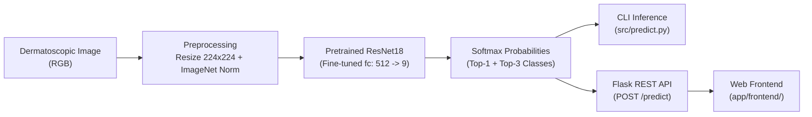
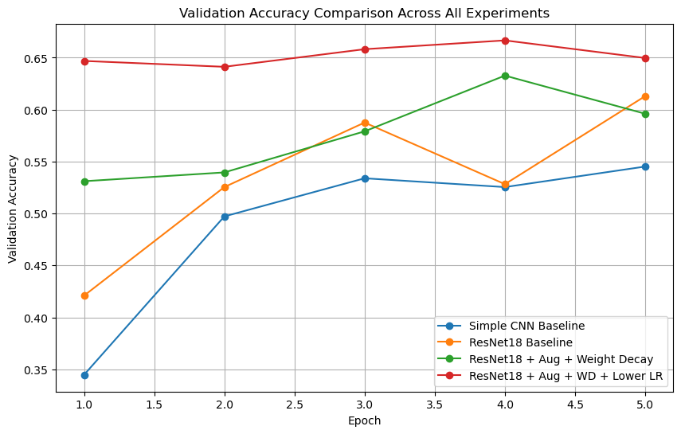
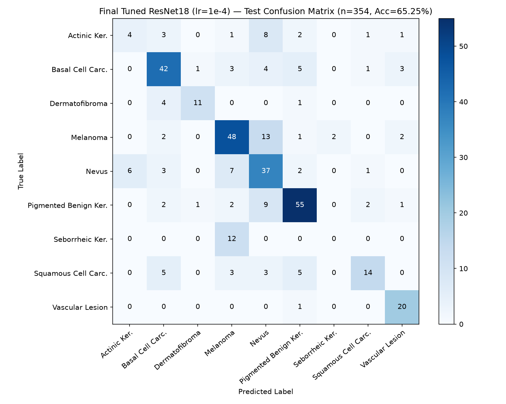
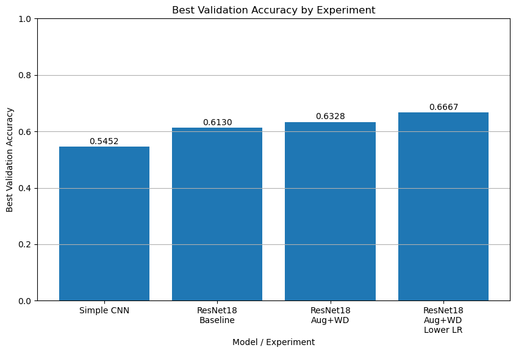
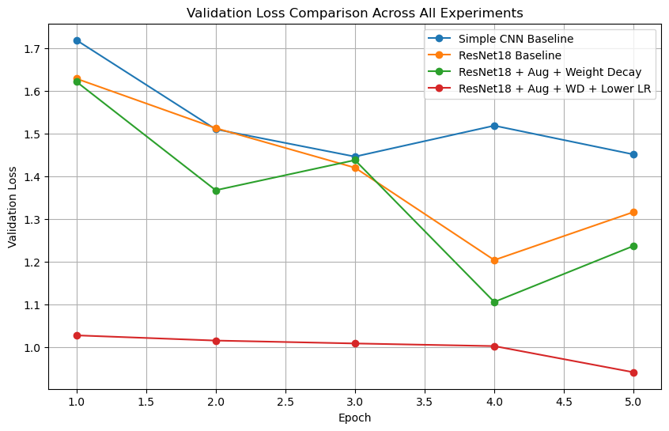

# MedMentor — Skin Lesion Classification (ResNet18)

> **Disclaimer:** MedMentor is an academic deep learning prototype developed at the **Euro-Mediterranean University of Fes (UEMF — EIDIA)** (2025–2026, Prof. Abdrahaman Waga). It is intended strictly for educational use and must not be used for clinical diagnosis.

MedMentor classifies dermatoscopic skin lesion images into **9 diagnostic classes** using transfer learning with a pretrained **ResNet18** convolutional neural network in PyTorch, exposed through a CLI inference module and a Flask REST API integrated with a web frontend.

---

## Architecture



---

## Project Contributions

MedMentor was built as a 2-person UEMF team project (**Bassma Alaoui & Salimata**):

| Component | Contributor | Details |
| :--- | :--- | :--- |
| **Deep Learning Pipeline & Model Evaluation** | **Bassma Alaoui** | Dataset inspection and stratified 70/15/15 split (`2,357` images), Simple CNN baseline vs. ResNet18 transfer learning experiments, data augmentation + weight decay + learning rate tuning, confusion matrix and per-class evaluation, `class_mapping.json`, and `predict.py` inference module |
| **Web Application & Database** | **Salimata** (`SSali042/AI_Menthor`) | HTML/CSS/JS frontend (`index.html`, `app.html`, `learn.html`), Flask authentication and chat endpoints (`app.py`), and MongoDB persistence |
| **Integration & Report** | **Joint** | Integrating `best_resnet18_augmented_lr1e4.pth` and `predict.py` into `POST /predict`, end-to-end testing, and final report (`docs/Rapport_MedMentor_AI.pdf`) |

> **Note on class schema:** The written report (`docs/Rapport_MedMentor_AI.pdf`) reflects an earlier 7-class HAM10000 design. The trained model weights (`models/best_resnet18_augmented_lr1e4.pth`) and `models/class_mapping.json` implement the final **9-class** ISIC skin lesion schema.

---

## Experiments & Evaluation Results

All four models trained in `notebooks/medmentor_model_work.ipynb` were evaluated on the held-out **354-image stratified test split** (`evidence/evaluation_metrics.json`):

| Experiment | Configuration | Best Val Acc | Test Acc (`n=354`) | Test Loss | Macro F1 | Weighted F1 |
| :--- | :--- | :---: | :---: | :---: | :---: | :---: |
| 1. Simple CNN Baseline (`128×128`) | Adam `lr=1e-3` | 54.52% | 47.18% | 1.6217 | 0.3570 | 0.4523 |
| 2. ResNet18 Baseline (`224×224`) | Adam `lr=1e-3` | 61.30% | 54.52% | 1.3690 | 0.4749 | 0.5317 |
| 3. ResNet18 + Aug + Weight Decay | Adam `lr=1e-3`, `wd=1e-4`, flip + rot(10°) | 63.28% | 58.76% | 1.1454 | 0.4995 | 0.5711 |
| 4. **ResNet18 + Aug + WD + Lower LR** *(final)* | **Adam `lr=1e-4`, `wd=1e-4`, flip + rot(10°)** | **66.67%** | **65.25%** | **1.0335** | **0.5700** | **0.6374** |

### Training Curves & Confusion Matrix

| Validation Accuracy Across Experiments | Final Model Confusion Matrix (`n=354`) |
| :---: | :---: |
|  |  |

| Best Validation Accuracy by Experiment | Validation Loss Curves |
| :---: | :---: |
|  |  |

See [docs/MODEL_CARD.md](docs/MODEL_CARD.md) for per-class precision/recall/F1 and error analysis (including class-imbalance impact on `seborrheic keratosis`), and [docs/DATASET.md](docs/DATASET.md) for dataset split and preprocessing details.

---

## Repository Structure

```text
medmentor-deep-learning/
├── models/
│   ├── best_resnet18_augmented_lr1e4.pth   # Trained ResNet18 weights (9 classes)
│   └── class_mapping.json                  # Class index-to-label mapping
├── notebooks/
│   ├── medmentor_model_work.ipynb          # Full training and evaluation notebook
│   └── 01_skin_lesion_baseline.ipynb       # Initial exploratory baseline notebook
├── src/
│   ├── predict.py                          # CLI and Python inference module
│   └── evaluate.py                         # ImageFolder test-set evaluation script
├── app/
│   ├── backend/                            # Flask REST API (app.py + predict.py)
│   └── frontend/                           # HTML/CSS/JS web interface
├── samples/                                # Representative ISIC test images for inference demos
├── evidence/
│   ├── confusion_matrix_final_resnet18.png
│   ├── evaluation_metrics.json
│   ├── sample_predictions.json
│   └── original_notebook_plots/
├── docs/
│   ├── MODEL_CARD.md
│   ├── DATASET.md
│   └── Rapport_MedMentor_AI.pdf
└── requirements.txt
```

---

## Quickstart

### 1. Install Dependencies

```bash
python3 -m venv .venv
source .venv/bin/activate
pip install -r requirements.txt
```

### 2. Run CLI Inference

```bash
python -m src.predict samples/basal_cell_carcinoma_ISIC_0024564.jpg
```

Output:

```json
{
  "prediction_main": "basal cell carcinoma",
  "confidence": "97.62%",
  "top3": [
    { "class_name": "basal cell carcinoma", "probability": "97.62%" },
    { "class_name": "squamous cell carcinoma", "probability": "0.96%" },
    { "class_name": "dermatofibroma", "probability": "0.95%" }
  ]
}
```

Testing `samples/sample_actinic_keratosis_ISIC_0025605.jpg` reproduces the notebook Cell 35 output (`squamous cell carcinoma`, `48.18%`), illustrating visual overlap between actinic keratosis and squamous cell carcinoma.

### 3. Run the Flask Inference API

```bash
cd app/backend
python app.py
```

```bash
curl -X POST http://127.0.0.1:5000/predict \
  -F "image=@../../samples/vascular_lesion_ISIC_0024375.jpg"
```

> `/health` and `/predict` run locally with PyTorch and Flask alone. Optional user authentication and chat history routes (`/signup`, `/login`, `/save-chat`, `/get-chats`) require MongoDB (`MONGO_URI`).

### 4. Re-run Test-Set Evaluation

```bash
python -m src.evaluate --test-dir /path/to/dataset_split/test
```
